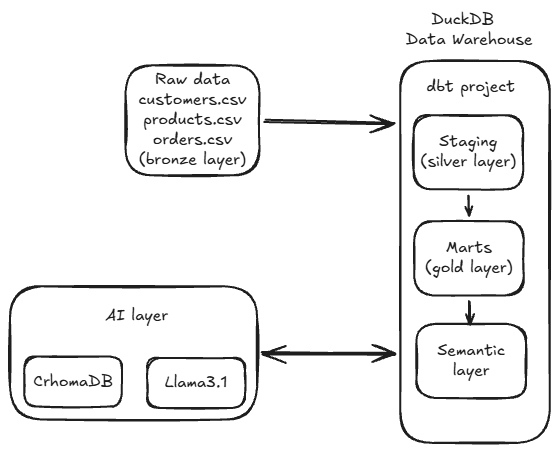
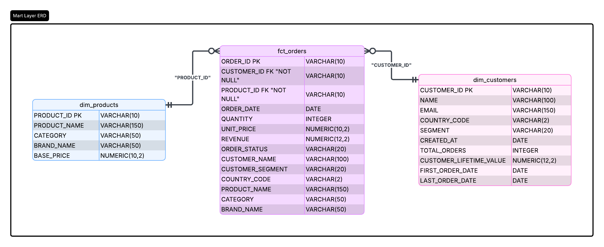

# SQL-Query-Agent

Ask an e-commerce business question in plain English, get an answer back from a
warehouse you can trust.

This is a learning project built to explore **dbt** (data build tool) and the
three-layer data architecture (raw → staging → marts), and then to bolt a
**local, offline text-to-SQL agent** on top of the curated gold layer. Nothing
here calls a cloud API: the warehouse is a single DuckDB file and the LLM runs
through Ollama on your own machine.



---

## Quickstart (Docker)

The only requirement is [Docker](https://docs.docker.com/get-docker/) with Compose.

```bash
git clone <this-repo> && cd SQL-Query-Agent
docker compose up -d --build
docker compose logs -f frontend      # wait for "You can now view your Streamlit app"
```

Then open **http://localhost:8501**.

What happens on `docker compose up`:

| Service | Role |
|---------|------|
| `ollama` | Ollama server (the local LLM runtime). |
| `ollama-pull` | One-shot job: downloads `llama3.1` (~5 GB) and preloads it into memory, then exits with code 0. |
| `frontend` | Starts once the model is ready. On creation it builds the warehouse (generate → ingest → dbt build), trains the vector store, then serves the Streamlit app. |

Only the model is persisted (volume `ollama-models`). The warehouse and vector
store are rebuilt every time the `frontend` container is recreated, so they
always match the dbt models and semantic layer baked into the image.

Useful commands:

```bash
docker compose run --rm frontend sql-query-agent ask "What is total revenue by product category?"
docker compose down          # stop everything (keeps the downloaded model)
docker compose down -v       # also delete the model volume
```

> **Performance note.** Without a GPU, `llama3.1` (8B) runs on the CPU and a
> question takes around **2 minutes**. The first run also downloads the model,
> which takes several minutes depending on your connection. For faster answers,
> try a smaller model (see [Configuration](#configuration)) or enable the GPU
> block in `docker-compose.yml` if you have an NVIDIA card.

---

## How it works

The pipeline has five stages, each one a subcommand of the `sql-query-agent` CLI:

| # | Stage | What it does | Command |
|---|-------|--------------|---------|
| 1 | **Generate** | Creates synthetic CSVs for a small e-commerce business, with deliberate data-quality problems baked into the orders file | `sql-query-agent generate` |
| 2 | **Ingest** | Loads the raw CSVs into DuckDB under a `raw` schema | `sql-query-agent ingest` |
| 3 | **Transform + Test** | dbt cleans the raw data (staging / silver), reshapes it into a star schema (marts / gold) and runs data tests: uniqueness, non-null keys, referential integrity, accepted values | `sql-query-agent transform` |
| 4 | **Train** | Vanna trains a local RAG store on the mart DDL, the semantic layer and example question → SQL pairs | `sql-query-agent train` |
| 5 | **Ask** | Translates a question to SQL with the local LLM and runs it against DuckDB | `sql-query-agent ask` / `sql-query-agent ui` |

`sql-query-agent pipeline` runs stages 1–4 in one go.

### The data model

Three layers live in one DuckDB file (`data/warehouse/warehouse.duckdb`):

- **`raw`**: CSVs loaded verbatim, every column a string.
- **`main_staging`**: one cleaned view per source (`stg_orders`, `stg_customers`,
  `stg_products`). `stg_orders` is where the mess gets fixed: mixed date formats
  are standardised, rows with a null `customer_id` are dropped, duplicate
  `order_id` rows are deduplicated (keeping the most recent), and non-positive
  quantities are filtered out.
- **`main_marts`**: the gold layer, a star schema:
  - `fct_orders`: one row per order, with `REVENUE` pre-computed and customer /
    product attributes denormalised in so most questions need no joins.
  - `dim_customers`: one row per customer, enriched with lifetime value, order
    count, and first / last order dates.
  - `dim_products`: one row per product.



### The semantic layer

`dbt_project/semantic/semantic_layer.yml` is a hand-written description of the
gold layer: the models, the metrics (`total_revenue`, `order_count`,
`avg_order_value`, `return_rate`, `cancellation_rate`, …) and the dimensions
(`order_date`, `customer_segment`, `country`, `product_category`, …) that are
available for questions. It is not a dbt-native construct; it exists so the AI
layer has curated, business-level context to train on instead of guessing from
raw column names. `dbt_project/analyses/validate_semantic_layer.sql` holds
queries that sanity-check those metrics against real data.

### The AI layer

`src/sql_query_agent/agent/` uses [Vanna](https://vanna.ai/) with a **ChromaDB**
vector store and **Ollama** (`llama3.1` by default) as the LLM. Training indexes:

- the `CREATE TABLE` DDL of each mart table, read from DuckDB,
- the model / metric / dimension docs from the semantic layer,
- the example question → SQL pairs in `agent/examples.yml` (add more there, no code changes needed).

At question time, Vanna retrieves the most relevant context and asks the local
model to write the query, which is then run against DuckDB.

---

## Local development (without Docker)

### Prerequisites

- Python 3.12 (see `.python-version`); 3.10+ works.
- [uv](https://docs.astral.sh/uv/) for dependency management.
- [Ollama](https://ollama.com/) running locally with the model pulled:
  ```bash
  ollama pull llama3.1
  ```

### Install and run

```bash
uv sync                                  # creates .venv, installs deps + the CLI
uv run sql-query-agent pipeline          # generate + ingest + dbt build + train
uv run sql-query-agent ask "Who are the top 5 customers by lifetime value?"
uv run sql-query-agent ui                # Streamlit on http://localhost:8501
```

Re-run `sql-query-agent transform` after changing dbt models, and
`sql-query-agent train` after changing the semantic layer or `examples.yml`
(delete `data/vector_store/` first for a clean store). dbt can also be run
directly from `dbt_project/` with `dbt build`.

### Tests and lint

```bash
uv run pytest
uv run ruff check src tests
```

The unit tests need neither Ollama nor a built warehouse.

### Example questions

- What is total revenue by product category?
- Who are the top 5 customers by lifetime value?
- How many orders were placed per country?
- What is the return rate by product category?
- What is the cancellation rate by customer segment?

---

## Configuration

Everything is optional. Defaults work out of the box, locally and in Docker.
To override, create a `.env` file at the project root (it is git-ignored) or
export the variables:

| Variable | Default | Purpose |
|----------|---------|---------|
| `SQA_OLLAMA_MODEL` | `llama3.1` | Ollama model. Also used by Docker Compose to pull it, e.g. `qwen2.5-coder:3b` for faster CPU answers. |
| `OLLAMA_HOST` | `http://localhost:11434` | Ollama server URL (set automatically in Docker). |
| `SQA_OLLAMA_TIMEOUT` | `600` | Seconds to wait for the LLM before giving up. |
| `SQA_OLLAMA_KEEP_ALIVE` | `1h` | How long Ollama keeps the model loaded between questions. |
| `SQA_RAW_DIR` | `data/raw` | Where generated CSVs are written. |
| `SQA_WAREHOUSE_PATH` | `data/warehouse/warehouse.duckdb` | DuckDB warehouse file. |
| `SQA_VECTOR_STORE_PATH` | `data/vector_store` | ChromaDB vector store. |

---

## Repository layout

```
├── src/sql_query_agent/          # all Python code, an installable package
│   ├── cli.py                    #   `sql-query-agent` entry point (all subcommands)
│   ├── config.py                 #   central paths + settings, env-overridable
│   ├── data/                     #   generate.py (synthetic CSVs), ingest.py (CSV -> DuckDB)
│   ├── agent/                    #   vanna_client.py, training.py, query_engine.py, examples.yml
│   └── frontend/                 #   streamlit_app.py
├── dbt_project/                  # transformation layer
│   ├── models/staging/           #   silver: cleaned views + sources + tests
│   ├── models/marts/             #   gold: fct_orders, dim_customers, dim_products
│   ├── semantic/                 #   semantic_layer.yml, consumed by the agent
│   └── analyses/                 #   semantic-layer validation queries
├── tests/                        # unit tests (no LLM / warehouse needed)
├── docker/entrypoint.sh          # first-start pipeline inside the container
├── Dockerfile                    # two-stage build (compiler only in the builder)
├── docker-compose.yml            # ollama + model pull + frontend
├── docs/                         # images, gold-layer DDL, star schema vs 3NF notes
├── data/                         # generated at runtime, git-ignored
├── pyproject.toml / uv.lock      # dependencies (single source of truth)
```

## Known constraints

- `chromadb==0.4.24` requires **NumPy < 2**, which in turn pins `pyarrow<26`.
  Upgrading chromadb would lift both, but needs checking against `vanna==0.7.4`.
- dbt runs with `threads: 1`: with several threads, `duckdb 1.1.3` under dbt
  intermittently crashed the interpreter. With six models it makes no practical difference.
- ChromaDB prints harmless `Failed to send telemetry event` warnings.

## Tech stack

DuckDB · dbt-core + dbt-duckdb · Vanna · ChromaDB · Ollama (llama3.1) ·
Streamlit · pandas · uv · Docker
